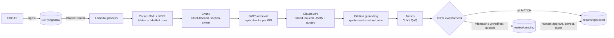

# LLM-Pipeline: SEC Filing KPI Extractor

A generative-AI pipeline that reads SEC **10-Q and 10-K** filings and extracts key performance indicators into clean, structured tables. **Every number carries a citation** back to the exact place in the filing, and **every number is checked against the company's XBRL-reported financials** before it can be used.

This is v1 of a larger "earnings call analyst agent". v2 adds earnings-call transcripts and management guidance (see [Roadmap](#roadmap)).

## Why

Analysts spend hours digging the same handful of figures out of 100+ page filings. LLMs can read those filings quickly, but an unverified LLM number isn't usable in finance. This pipeline treats XBRL, the machine-readable financial data every public company files with the SEC, as **built-in ground truth**. Each extracted value is graded automatically, and anything that doesn't reconcile is routed to a person.

## How it works



1. **Ingestion.** `ingest_handler` pulls the latest filing and companyfacts from EDGAR into S3. Writing `filings/raw/{cik}/{accession}.htm` fires the processing Lambda.
2. **Retrieval (RAG).** The filing HTML (including inline XBRL) is parsed into text. Financial tables are flattened into `label | value | value` rows, and `Item N.` sections are detected. Text is split into section-aware chunks with exact character offsets. A BM25 index then returns the top-k chunks per KPI, favouring the financial statements and MD&A. This keeps prompts small and the model focused.
3. **Extraction.** Claude is forced to call a `record_kpi` tool (temperature 0), so output is always schema-shaped JSON. For each value it returns: period end, duration (3M/6M/9M/12M/instant), the number as printed, the unit scale (thousands/millions/billions), the source chunk id, and a verbatim quote.
4. **Citation grounding.** Each quote is checked to exist verbatim in the cited chunk and to contain the extracted number. Verified citations resolve to the section and character span in the parsed document.
5. **Trends.** YoY comes from the comparative columns printed in the same filing. QoQ uses the company's history of previously approved filings.
6. **Validation (eval harness).** Every value is looked up in XBRL company facts by tag, period end and duration, preferring the fact reported by this same filing. Statuses:

   | Status | Meaning |
   |---|---|
   | `MATCH` | Within 0.5% (or ±$0.011 for EPS) of XBRL, citation verified |
   | `MISMATCH` | Disagrees with XBRL. Notes flag likely unit-scale or sign errors |
   | `CITATION_UNVERIFIED` | Quote not found in the cited text (possible hallucination) |
   | `NO_GROUND_TRUTH` | No XBRL fact for that period (e.g. company doesn't tag gross profit) |
   | `MISSED` | XBRL says the filing reported the KPI, but extraction didn't find it |

7. **Human-in-the-loop.** Anything not `MATCH` goes to `review/pending/`. Results stay in `results/staged/` and are **only published to `results/approved/` once every flagged item is resolved**, with corrections applied and an audit trail of reviewer, decision and original value. Approved values then feed the QoQ history.

**KPIs (v1):** total revenue, gross profit, operating income, net income, diluted EPS, operating cash flow, and cash & equivalents. Add more in [`config.py`](src/kpi_pipeline/config.py) by listing the XBRL tags and a retrieval query.

## Quickstart

```bash
pip install -e ".[dev]"
export ANTHROPIC_API_KEY=sk-ant-...
export SEC_USER_AGENT="Your Name you@example.com"   # SEC requires a contact email

kpi run --ticker AAPL --form 10-Q        # latest 10-Q: extract, validate, queue reviews
kpi review list                          # what needs a human
kpi review show   <FILING_ID>/<ITEM_ID>
kpi review correct <FILING_ID>/<ITEM_ID> --value 94930000000 --note "used total net sales"
kpi review approve <FILING_ID>/<ITEM_ID>
```

Results land in `./data/results/{staged,approved}/`. Run a local file with `kpi run --file filing.htm --meta meta.json --facts companyfacts.json`.

## Evaluation

```bash
kpi eval --manifest evals/manifest.json
```

This runs the pipeline over a set of real filings and writes `data/evals/report_*.json` with value accuracy vs XBRL, citation-verified rate, KPI coverage, misses, and a per-KPI status breakdown. Because ground truth comes from XBRL, you can grow the eval set to hundreds of filings with no hand labelling.

## Deploy to AWS

```bash
aws secretsmanager create-secret --name anthropic-api-key --secret-string "sk-ant-..."
sam build -t infra/template.yaml
sam deploy --guided   # set AnthropicApiKeySecretArn, SecUserAgent, Tickers
```

The stack creates an encrypted, private S3 bucket and two Lambdas:
- `process`, triggered by uploads to `filings/raw/*.htm`
- `ingest`, on a daily schedule for the configured tickers

You can also push a filing manually with `kpi ingest --ticker MSFT --bucket <bucket>`.

## Tests

```bash
pytest
```

25 tests cover:
- Parsing, chunk offsets, section boundaries and retrieval
- Scaling, negatives and citation grounding (including hallucinated quotes)
- XBRL lookup and every validation status
- YoY/QoQ trends
- The Claude tool-call contract, with a mocked client
- The full review lifecycle: correct, reject, and fill a missed KPI
- The CLI, and S3 + Lambda end to end (via `moto`)

The tests use a synthetic 10-Q with matching companyfacts and a deterministic stand-in extractor, so they run offline with no API key.

## Project layout

```
src/kpi_pipeline/
  edgar.py         EDGAR client (tickers, filings, documents, companyfacts)
  parsing.py       HTML/iXBRL to text, table rows, sections, dei metadata
  chunking.py      section-aware, offset-tracked chunks
  retrieval.py     BM25 index
  extraction.py    Claude tool-use extraction + citation grounding
  trends.py        YoY / QoQ
  xbrl.py          companyfacts ground-truth lookup
  validation.py    eval harness + run metrics
  review.py        human-in-the-loop queue and publishing
  pipeline.py      orchestration
  storage.py       local and S3 backends (same key layout)
  lambda_handler.py, cli.py, eval_runner.py
infra/template.yaml  AWS SAM stack
tests/               offline test suite + fixtures
evals/manifest.json  real-filing eval set
```

## Roadmap

- **v2:** earnings-call transcripts and management guidance, guidance-vs-actual tracking, and an agent that answers analyst questions over filings + calls
- Segment-level and company-specific KPIs (e.g. ARR, same-store sales), validated against XBRL extension tags
- Q4 derivation (FY minus 9M YTD) for QoQ on 10-K periods
- Hybrid retrieval (BM25 + embeddings) for narrative KPIs
- A review UI on top of the review queue
